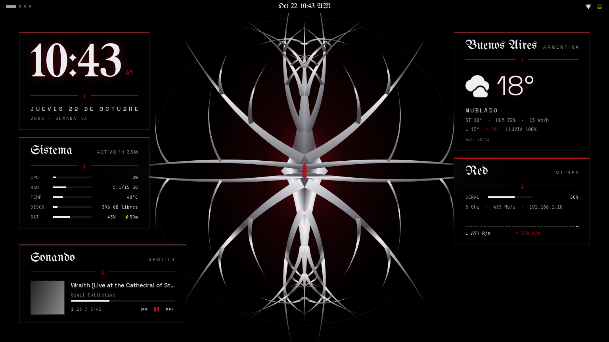

<div align="center">

# ⸸ dotfiles ⸸

**Arch Linux · GNOME 51 · Wayland** — rice cibersigilista en negro, cromo y rojo sangre



</div>

## Detalles

| | |
|---|---|
| **Distro** | Arch Linux (kernel zen) |
| **Escritorio** | GNOME 51 (Wayland) + GDM |
| **Tema de shell** | Cybersigil (propio, vía User Themes) |
| **GTK** | adw-gtk3-dark + overrides de libadwaita |
| **Iconos / Cursor** | Papirus-Dark (carpetas negras) / Bibata Modern Classic |
| **Terminal** | kitty |
| **Shell / Prompt** | bash + starship + fzf |
| **Fuentes** | Space Grotesk · JetBrainsMono Nerd Font · UnifrakturMaguntia |
| **Monitor** | btop |
| **Extensiones** | Just Perfection · User Themes · Blur my Shell · Tiling Shell · Cybersigil Widgets (propia) |

## Widgets de escritorio

Extensión propia (`home/.local/share/gnome-shell/extensions/cybersigil-widgets@donza`), en cristal negro
semitransparente con desenfoque y la paleta del tema:

| Widget | Muestra |
|---|---|
| Reloj | hora gótica (12 o 24 h, según GNOME), fecha y semana |
| Sistema | CPU, RAM, temperatura, disco y batería; las barras se ponen rojas al pasar el umbral |
| Clima | tu ciudad (Open-Meteo, sin cuenta ni clave): temperatura, estado, mín./máx. y lluvia |
| Red | WiFi o cable, señal, banda, IP y tráfico en vivo con gráfico del último minuto |
| Música | lo que suena en Spotify, YouTube (Brave/Firefox) o cualquier reproductor MPRIS, con controles |

Cuáles se muestran, dónde, opacidad y desenfoque se cambian en `palette.sh` (sección *Widgets*). La ciudad
va en `~/.config/cybersigil/local.sh`, que no se sube al repo:

```bash
WEATHER_CITY="Rosario"; WEATHER_REGION="Santa Fe"; WEATHER_LAT=-32.95; WEATHER_LON=-60.65
```

Todo se aplica con `cybersigil-apply` y volviendo a iniciar sesión. Los widgets con la misma posición se
apilan y comparten el ancho.

Consumo medido: ~0,2 % de un núcleo en reposo. Un widget tapado por completo por una ventana se
oculta y deja de medir (si no, se repintaría con su desenfoque cada vez que esa ventana se redibuja),
y la posición de la música se calcula localmente en vez de consultarle al reproductor cada segundo.

## Paleta

| Token | Color | Uso |
|---|---|---|
| `BG` | `#000000` | fondo base |
| `SURFACE` | `#141416` | menús y tarjetas |
| `TEXT` | `#d8d8dc` | texto |
| `CHROME` | `#9a9aa2` | bordes y líneas |
| `CHROME_HI` | `#f0f0f4` | brillo del cromo |
| `ACCENT` | `#8b0a14` | rojo sangre |

Todo el tema sale de un solo archivo: [`palette.sh`](home/.config/cybersigil/palette.sh).
Cambia un color y ejecuta `cybersigil-apply`: se regeneran el tema de GNOME Shell, GTK, kitty, starship, fastfetch, btop, fzf y el wallpaper (SVG generado por código).

## Estructura

```
home/            → se enlaza tal cual dentro de ~ (misma estructura que $HOME)
  .config/cybersigil/   palette.sh, apply.sh, system-tune.sh y plantillas
firefox/user.js  → Firefox sin telemetría
dconf/           → ajustes de GNOME y de las extensiones
packages/        → paquetes de pacman, AUR y extensiones de GNOME
fonts/           → fuentes que no están en los repos
plantillas/      → plantillas de Nautilus (clic derecho → Nuevo documento); se copian, no se enlazan
assets/          → imágenes del README
install.sh       → instala todo
backup.sh        → actualiza dconf/ y packages/
```

## Instalación

```bash
git clone https://github.com/MaximoSDonza/dotfiles.git ~/dotfiles
cd ~/dotfiles

sudo pacman -S --needed - < packages/pacman.txt
yay -S --needed - < packages/aur.txt
./install.sh
sudo bash ~/.config/cybersigil/system-tune.sh   # WiFi, zram, thermald, GDM...
```

Cierra sesión y vuelve a entrar. Los archivos que ya existían se mueven a `~/.dotfiles-backup/`.

## Ajustes de sistema (`system-tune.sh`)

- WiFi MediaTek MT7902: sin ahorro de energía ni ASPM, dominio regulatorio AR
- TCP BBR + fq
- zram = RAM/2 con parámetros de memoria para zram
- thermald, rtkit (prioridad en tiempo real para el dibujado y el audio), limpieza semanal de la caché de pacman
- xdg-terminal-exec: kitty como terminal de las apps del menú
- GDM (necesario para bloquear con Super+L)

Cada cambio se puede revertir con los comandos del final del script.

## Atajos

| Atajo | Acción |
|---|---|
| `Super + L` | bloquear |
| `Ctrl + Alt + T` | abrir kitty |
| `Super + ←/→/↑/↓` | mover ventana entre tiles |
| `Super + Ctrl + flechas` | cambiar el foco entre ventanas |
| `Ctrl + R` | buscar en el historial (fzf) |
| `Ctrl + T` | buscar archivos (fzf) |
| `Alt + C` | saltar a una carpeta (fzf) |

## SSH en kitty

En kitty, `ssh` es `kitten ssh`: la primera vez copia al servidor la definición de la terminal
(`xterm-kitty`), así nano, htop y clear funcionan con todos los colores. Para equipos sin shell
(routers, switches) usar `ssh-plain`, que conecta como `xterm-256color`.

## Herramientas

- `cybersigil-apply`: regenera el tema desde `palette.sh`
- `suspend-drain`: suspende la laptop y mide cuánta batería gasta por hora
- `jetbrains-update-check`: JetBrains Toolbox no arranca con la sesión (~500 MB y CPU en segundo plano);
  este script, con su temporizador de systemd, avisa una vez por versión cuando hay una actualización de
  un IDE, con un botón para abrir Toolbox. Los IDEs se abren directo, sin Toolbox

## Privacidad

Lo privado de cada máquina queda fuera del repo: `~/.config/cybersigil/local.sh` (ciudad), `~/.bashrc.local`
(variables secretas) y `~/.npmrc` (token de npm). Un hook de git (`.githooks/pre-commit`) frena commits
con tokens, claves o esos archivos.


Telemetría desactivada en VS Code, Firefox y CLIs de desarrollo (`gh`, Next.js, Astro, Angular, Turbo, Prisma...): ver [`90-no-telemetry.conf`](home/.config/environment.d/90-no-telemetry.conf).

## Mantener el respaldo

```bash
cd ~/dotfiles && ./backup.sh && git add -A && git commit -m "update" && git push
```

## Créditos

Fuentes bajo licencia [OFL](https://openfontlicense.org) (texto en `fonts/`): Space Grotesk, UnifrakturMaguntia.
Extensiones de [extensions.gnome.org](https://extensions.gnome.org).
